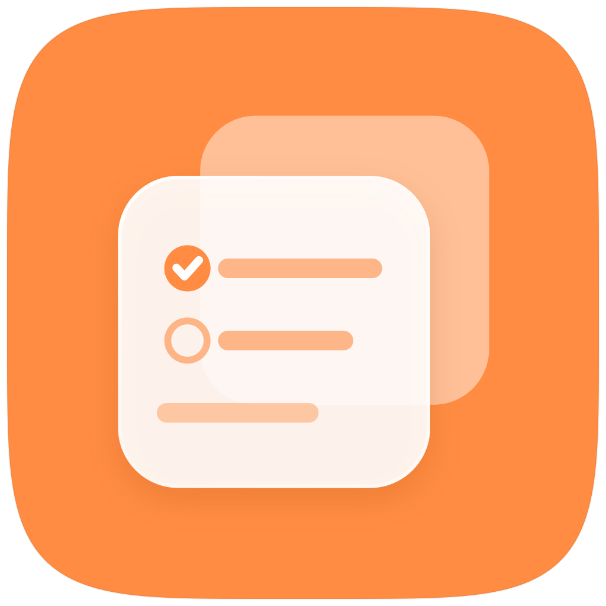
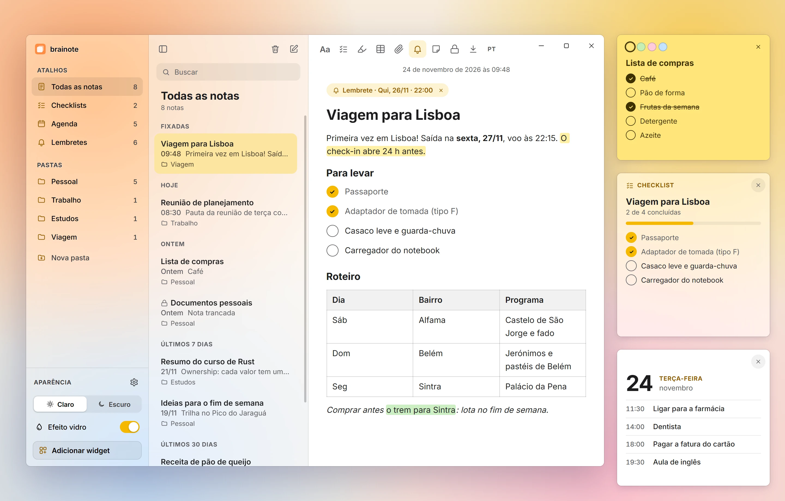
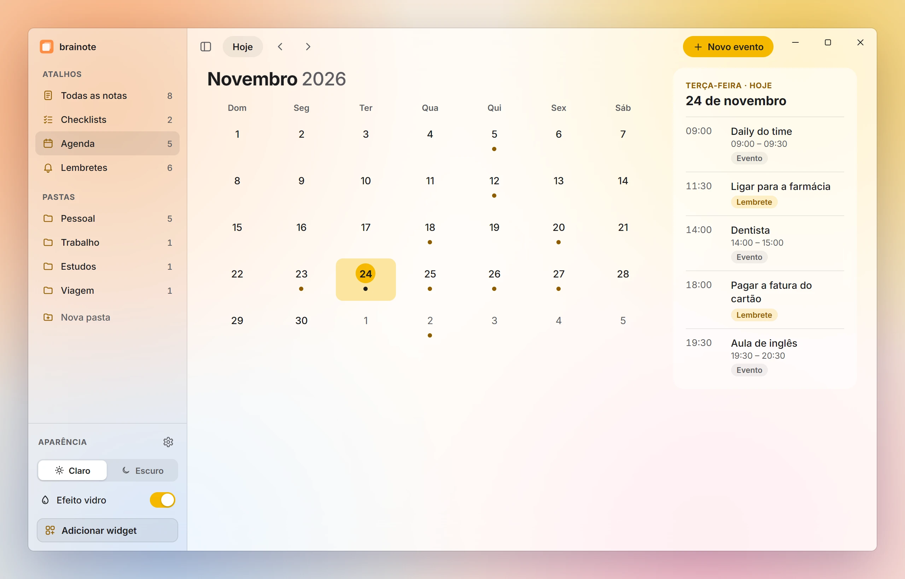
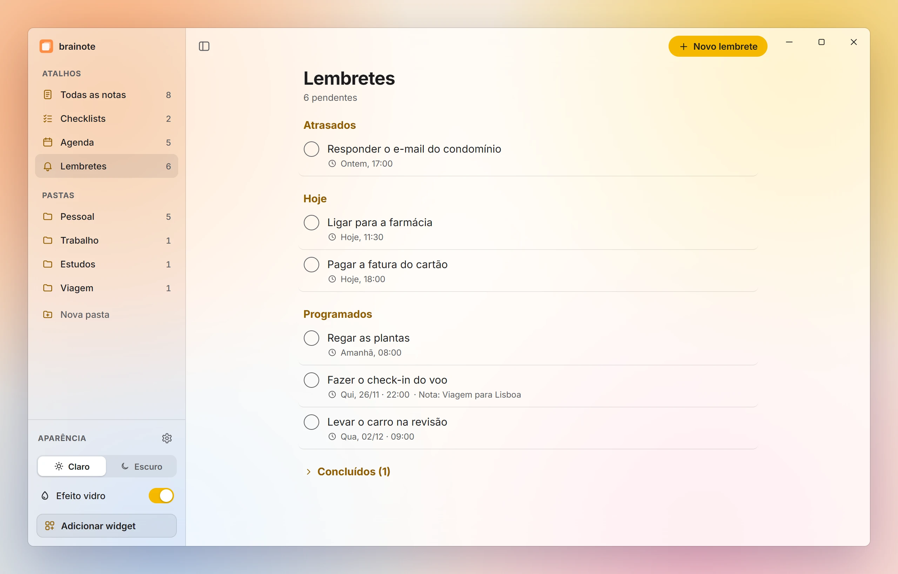
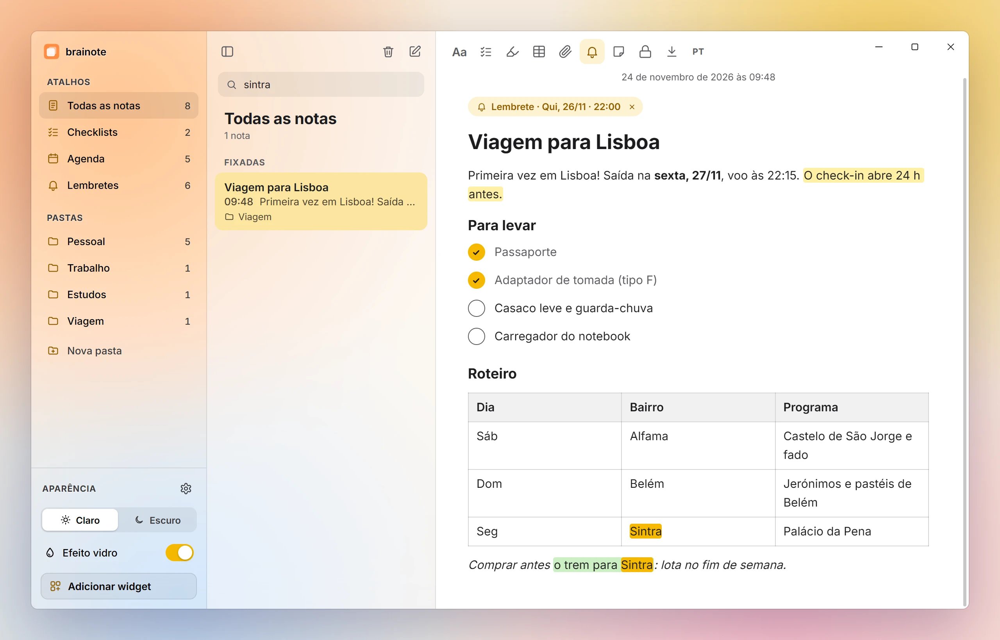
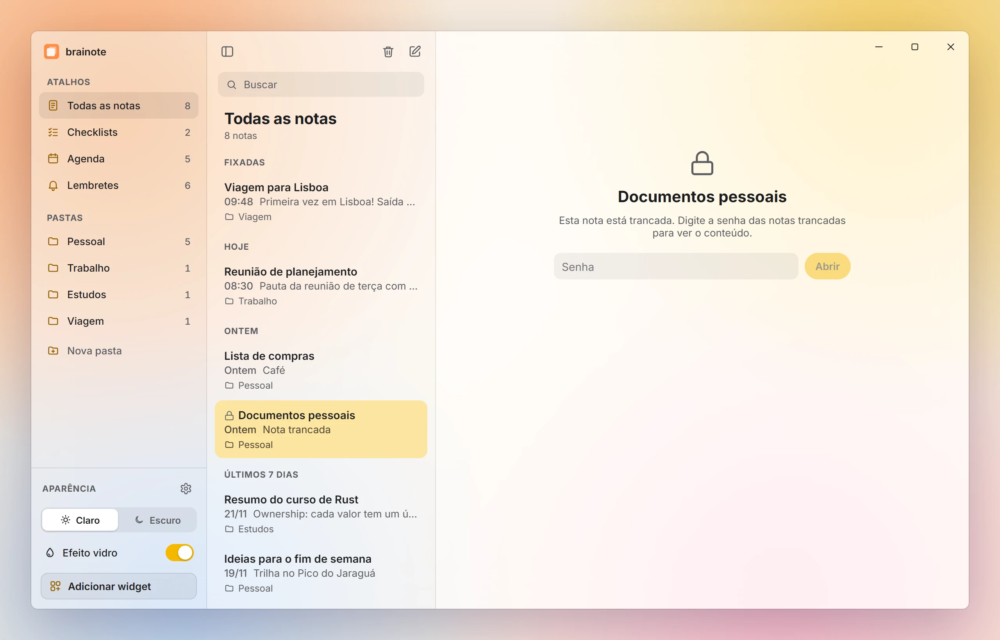
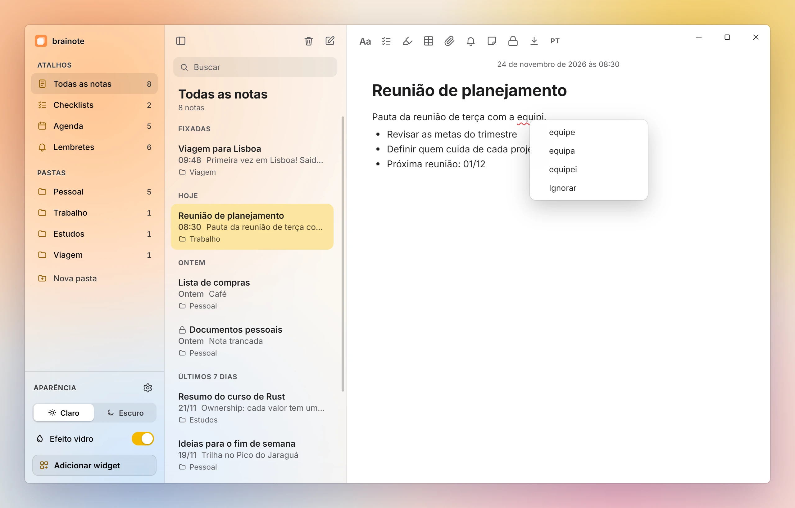
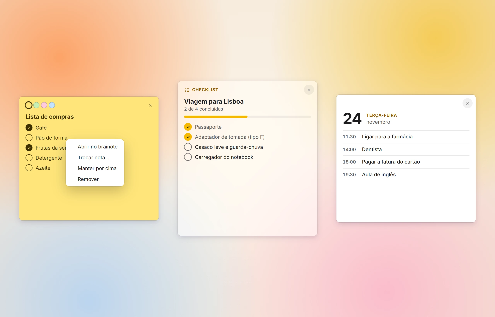

<div align="center">

<picture>
  <source media="(prefers-color-scheme: dark)" srcset="assets/icone/brainote-escuro-1024.png">
  
</picture>

<h1>brainote</h1>

<p><b>Notas, checklists, agenda e lembretes num app leve para o Windows 11,<br>com post-its de verdade na área de trabalho.</b></p>

<p>Tudo fica no seu computador: sem nuvem, sem login e sem telemetria.</p>


</div>

<br>

<picture>
  <source media="(prefers-color-scheme: dark)" srcset="docs/imagens/capa-escuro.webp">
  
</picture>

<p align="center"><sub>As imagens seguem o tema do seu GitHub (claro ou escuro) e usam dados de exemplo.</sub></p>

## O que é

O brainote é um app pessoal de notas para o Windows 11, com o visual e a simplicidade do Notas do macOS. Ele fica aberto o dia todo na bandeja do sistema (perto do relógio), abre junto com o Windows e coloca suas notas, tarefas e compromissos ao alcance de um clique, inclusive como widgets na área de trabalho.

<table>
  <tr>
    <td width="33%" valign="top">
      
      <h3>Notas ricas</h3>
      Títulos, listas, marca-texto, checklists, tabelas, imagens e anexos. Salva sozinho enquanto você digita.
    </td>
    <td width="33%" valign="top">
      
      <h3>Lembretes</h3>
      Notificação do Windows com os botões <b>Concluir</b> e <b>Adiar 10 min</b>, e repetição por dias da semana, mês ou ano.
    </td>
    <td width="33%" valign="top">
      
      <h3>Agenda</h3>
      Calendário do mês com eventos e lembretes, e o painel do dia com tudo em ordem de horário.
    </td>
  </tr>
  <tr>
    <td valign="top">
      
      <h3>Widgets</h3>
      Post-it, checklist e agenda de hoje como janelas próprias na área de trabalho, sempre sincronizados com o app.
    </td>
    <td valign="top">
      
      <h3>Notas com senha</h3>
      Conteúdo criptografado com Argon2id e XChaCha20-Poly1305. A senha nunca é guardada.
    </td>
    <td valign="top">
      
      <h3>Efeito vidro</h3>
      Barra lateral bem transparente, lista translúcida e editor sólido, nos temas claro e escuro. O vidro não apaga quando a janela perde o foco.
    </td>
  </tr>
</table>

## Telas

<table>
  <tr>
    <td width="50%" valign="top">
      <picture>
        <source media="(prefers-color-scheme: dark)" srcset="docs/imagens/agenda-escuro.webp">
        
      </picture>
      <p align="center"><b>Agenda</b><br><sub>O mês inteiro, com o painel do dia ao lado.</sub></p>
    </td>
    <td width="50%" valign="top">
      <picture>
        <source media="(prefers-color-scheme: dark)" srcset="docs/imagens/lembretes-escuro.webp">
        
      </picture>
      <p align="center"><b>Lembretes</b><br><sub>Atrasados, Hoje, Programados e Concluídos.</sub></p>
    </td>
  </tr>
  <tr>
    <td width="50%" valign="top">
      <picture>
        <source media="(prefers-color-scheme: dark)" srcset="docs/imagens/busca-escuro.webp">
        
      </picture>
      <p align="center"><b>Busca com destaque</b><br><sub>A palavra buscada aparece marcada dentro da nota.</sub></p>
    </td>
    <td width="50%" valign="top">
      <picture>
        <source media="(prefers-color-scheme: dark)" srcset="docs/imagens/trancada-escuro.webp">
        
      </picture>
      <p align="center"><b>Nota trancada</b><br><sub>Só o título fica visível até digitar a senha.</sub></p>
    </td>
  </tr>
  <tr>
    <td width="50%" valign="top">
      <picture>
        <source media="(prefers-color-scheme: dark)" srcset="docs/imagens/corretor-escuro.webp">
        
      </picture>
      <p align="center"><b>Corretor</b><br><sub>O do próprio Windows para o português, com sugestões no botão direito.</sub></p>
    </td>
    <td width="50%" valign="top">
      <picture>
        <source media="(prefers-color-scheme: dark)" srcset="docs/imagens/widgets-escuro.webp">
        
      </picture>
      <p align="center"><b>Widgets</b><br><sub>O mesmo menu do app no botão direito, com "Trocar nota…".</sub></p>
    </td>
  </tr>
</table>

## Tudo o que o brainote faz

### Notas e pastas
- Pastas com contador de notas. Criar, renomear e apagar pastas; ao apagar uma pasta, as notas dela vão para "Sem pasta".
- Atalhos na barra lateral: **Todas as notas**, **Checklists** (notas com algum item de checklist), **Agenda** e **Lembretes**.
- Lista agrupada por data: **Fixadas**, **Hoje**, **Ontem**, **Últimos 7 dias**, **Últimos 30 dias** e depois um grupo por mês.
- Botão direito numa nota: fixar, mover para pasta, fixar na área de trabalho, trancar e apagar. Também dá para arrastar a nota até uma pasta.
- Ao apagar uma nota, aparece **"Desfazer"** por 6 segundos. A nota apagada é removida de vez depois de 30 dias.
- **Salvamento automático** meio segundo depois da última tecla. Não existe botão "Salvar".

### Editor
- Menu **Aa**: título, subtítulo, corpo, lista com marcadores, lista numerada, negrito, itálico, sublinhado e riscado.
- **Marca-texto** em tons pastel (azul, amarelo, verde, vermelho e laranja). O **modo caneta** marca cada trecho arrastado, e a **borracha** tira a marca do mesmo jeito. Nos dois, o cursor de texto mostra a cor da ferramenta, para você ver onde a marca começa.
- **Checklists**: o item marcado fica no mesmo lugar. Enter cria outro item, Enter num item vazio sai do checklist e Ctrl+Enter marca ou desmarca.
- **Tabelas**: Tab anda entre as células (na última, cria uma linha). Com o botão direito você adiciona ou remove linhas e colunas, e arrastando a borda muda a largura.
- **Imagens** (PNG, JPG, GIF, WebP e BMP): pelo clipe da barra, arrastando do Explorador ou colando com Ctrl+V, inclusive print de tela. O canto de baixo muda o tamanho sem distorcer.
- **Anexos** de qualquer tipo, até 100 MB por arquivo. Clicar abre no programa padrão do Windows, e o botão direito oferece "Salvar como…" e "Remover".
- **Exportar a nota** em `.md` ou `.txt`, levando junto uma pasta com as imagens e os anexos.
- **Corretor ortográfico**, sem internet: o português usa o corretor do próprio Windows (o mesmo do Edge e do Teams), e o inglês, um dicionário que vem no app. Uma palavra certa em qualquer um dos dois idiomas não fica sublinhada. Sugestões no botão direito, no texto e no título.
- Botão **PT/EN** na barra do editor: escolhe o idioma principal de cada nota, de onde vêm primeiro as sugestões.
- **Correção automática** ligada (dá para desligar nas Configurações): "voce" vira "você" e "concerteza" vira "com certeza" ao digitar o espaço. No texto da nota, o Ctrl+Z desfaz a troca.

### Busca
- Procura no título e no conteúdo, pelo começo das palavras e sem diferenciar acentos.
- A nota aberta mostra as palavras encontradas **destacadas** e rola até a primeira.

### Notas com senha
- Uma senha só para todas as notas trancadas, como no Notas do Mac, com uma **dica opcional** que aparece quando a senha é digitada errada.
- O título continua visível. O conteúdo fica fora da busca, da prévia e dos widgets.
- As notas trancadas ficam abertas até você trancar de novo: ao fechar a janela, pelo cadeado **"Trancar agora"** ou ao abrir o app.
- Nota trancada não aceita imagem nem anexo.
- **Não há como recuperar a senha.** Se você esquecer, as notas trancadas ficam inacessíveis.

### Lembretes
- Notificação do Windows mesmo com a janela fechada, com os botões **Concluir** e **Adiar 10 min**. Clicar na notificação abre o lembrete no app.
- Repetição pelos dias da semana (bolinhas **D S T Q Q S S**), **mensal** ou **anual**. O dia 31 cai no último dia dos meses menores, e o 29/02 cai no 28/02 nos anos que não são bissextos.
- Data num calendário e hora em duas "rodas", no estilo do relógio do iPhone.
- Pode ficar ligado a uma nota, e então aparece como um chip no topo dela.
- Ao abrir o app, avisa numa notificação só os lembretes que venceram com o computador desligado.

### Agenda
- Calendário do mês, com um ponto nos dias que têm compromisso.
- O painel do dia mostra eventos e lembretes em ordem de horário.
- Eventos com hora de início e de fim ou de dia inteiro, que podem ficar ligados a uma nota.

### Widgets na área de trabalho
- **Post-it** de uma nota, em 4 cores (amarelo, verde, rosa e azul), com checklist marcável e imagens. Um duplo clique abre a nota no app.
- **Checklist** com "X de Y concluídas" e barra de progresso. É o único widget com efeito vidro; post-it e agenda ficam com cor sólida.
- **Agenda de hoje** com os próximos 4 compromissos e lembretes do dia.
- Cada widget é uma janela própria, fora da barra de tarefas, que fica no fundo da área de trabalho ou por cima das janelas. A posição e o tamanho ficam salvos.
- Botão direito no widget: o mesmo menu do app, com **Abrir no brainote**, **Trocar nota…** (escolhe outra nota para o post-it ou o checklist), **Manter por cima** e **Remover**.
- Marcar um item no widget marca na nota, e o contrário também.
- Com **Win+D**, os widgets continuam visíveis na frente da área de trabalho.

### Aparência
- Tema **claro** ou **escuro**, com o amarelo de destaque e a fonte Inter já incluída no app.
- **Efeito vidro** com o acrílico clássico do Windows (o mesmo efeito do TranslucentRM, do Rainmeter), que liga e desliga na hora. A barra lateral é sempre a coluna mais transparente, a lista de notas fica translúcida e o editor sólido. O vidro continua igual quando você clica em outra janela.
- Barras de rolagem, listas suspensas e seletores próprios, nas cores do tema.

### Bandeja e inicialização
- Fechar a janela esconde o app na bandeja; ele só fecha pelo item **Sair**.
- O menu da bandeja tem **Abrir brainote**, **Nova nota**, **Widgets** e **Sair**.
- Inicia com o Windows já na bandeja, com os widgets na tela. Dá para desligar nas Configurações.
- Abrir o app de novo só traz a janela que já está aberta para a frente.

### Backup
- **Exportar backup** gera um `.zip` com todas as notas, pastas, lembretes, eventos, widgets e anexos.
- **Importar backup** aceita o `.zip` e também os `.json` antigos. Antes de substituir, o app guarda uma cópia do banco e dos anexos atuais.

## Privacidade e segurança

- Os dados ficam só em `%APPDATA%\brainote`: o banco SQLite `brainote.db` e a pasta `anexos`.
- O app não faz chamadas de rede. Só o próprio Windows se comunica para mostrar as notificações.
- **Notas com senha:** a chave sai da senha com **Argon2id** (64 MB, 3 passadas e sal aleatório), e o conteúdo é cifrado com **XChaCha20-Poly1305**. A senha não é guardada, e a chave fica só na memória enquanto as notas estão abertas.
- O banco apaga de verdade o texto removido (`secure_delete`, inclusive no índice da busca).
- O backup leva as notas trancadas ainda criptografadas, e a mesma senha abre essas notas depois de importar.

## Instalação

O instalador é gerado a partir do código e instala **só para o seu usuário**, sem precisar de administrador.

1. Instale os pré-requisitos: [Node.js LTS](https://nodejs.org/), [Rust](https://rustup.rs/), as [Microsoft C++ Build Tools](https://visualstudio.microsoft.com/visual-cpp-build-tools/) e o WebView2 (que já vem no Windows 11).
2. Na pasta do projeto, rode:

   ```powershell
   npm install
   npm run tauri build
   ```

3. Abra o instalador gerado em `src-tauri\target\release\bundle\nsis\brainote_1.3.0_x64-setup.exe`.

> [!NOTE]
> O executável não tem assinatura digital. Na primeira vez, o SmartScreen pode avisar: clique em **Mais informações** e depois em **Executar assim mesmo**.

## Desenvolvimento

| Comando | O que faz |
|---|---|
| `npm run tauri dev` | Abre o app em modo de desenvolvimento, que recarrega a cada mudança. Feche o brainote instalado antes. |
| `npm test` | Roda os testes da interface: datas, conteúdo das notas, corretor e destaque da busca. |
| `cargo test` (dentro de `src-tauri`) | Roda os testes do backend: banco, lembretes, criptografia, backup, anexos e corretor. |
| `npm run tauri build` | Gera o instalador em `src-tauri/target/release/bundle/`. |

### Como é feito

| Parte | Tecnologia |
|---|---|
| App e janelas | [Tauri 2](https://tauri.app/), com o backend em Rust |
| Interface | React 19, TypeScript e Vite, com CSS puro e variáveis de tema |
| Editor | [TipTap 3](https://tiptap.dev/), com listas de tarefas, tabelas, imagens e marca-texto |
| Banco | SQLite com `rusqlite`, migrações versionadas e busca FTS5 |
| Corretor | Corretor do Windows (Spell Checking API) para o português e dicionário Hunspell com o crate `spellbook` para o inglês |
| Criptografia | `argon2` e `chacha20poly1305` |
| Sistema | Plugins oficiais do Tauri (instância única, iniciar com o Windows, diálogos e posição da janela) e notificações nativas do Windows |

### Estrutura

```text
src/                  interface (React)
  App.tsx             janela principal: barra lateral, lista e editor
  Editor.tsx          editor TipTap e a barra de ferramentas
  TitleField.tsx      título da nota com o corretor
  Agenda.tsx          calendário do mês e o painel do dia
  Reminders.tsx       tela de lembretes
  Widget.tsx          post-it, checklist e agenda de hoje
  Locked.tsx          senha e tela da nota trancada
  api.ts              ponte para os comandos do Rust
src-tauri/src/        backend (Rust)
  lib.rs              comandos, bandeja e inicialização
  store.rs            banco SQLite, migrações e busca
  vault.rs            criptografia das notas com senha
  background.rs       agendador e notificações dos lembretes
  widgets.rs          janelas dos widgets
  desktop.rs          efeito vidro e Win+D
  attachments.rs      imagens e anexos
  spell.rs            corretor ortográfico (português e inglês)
  winspell.rs         corretor do Windows para o português
docs/
  ESPECIFICACAO.md    o que o app faz, em detalhe
  TESTES.md           roteiro de testes de cada versão
```

## Versões

| Versão | O que trouxe |
|---|---|
| **1.0** | Notas e pastas, checklists, lembretes com notificação, agenda, widgets, tema claro e escuro, efeito vidro, bandeja e backup. |
| **1.1** | Post-it sempre claro, rolagem e listas próprias, seletores de data e hora, repetição por dias da semana, exportar nota, arrastar notas para pastas, marca-texto, corretor e correção automática. |
| **1.2** | Imagens e anexos, backup em `.zip`, destaque da busca, vidro sem foco, tabelas e notas com senha. |
| **1.3** | Vidro novo (barra lateral mais transparente, lista translúcida e editor sólido), menu e troca de nota nos widgets, Win+D e Win+V corrigidos, corretor do Windows para o português, idioma por nota, correção no título e cursor de texto. |
| **1.4** *(planejada)* | Agenda externa: mostrar um calendário do Outlook ou do Google pelo link ICS, só para leitura. |

## Créditos

- Fonte [Inter](https://rsms.me/inter/), licença SIL Open Font License.
- Dicionário pt-BR do projeto VERO/LibreOffice (LGPL-3.0 ou MPL-2.0; usado quando o Windows não tem o corretor de português) e dicionário en-US do SCOWL (MIT e BSD), pelo pacote [wooorm/dictionaries](https://github.com/wooorm/dictionaries). As licenças estão em `src-tauri/dicionarios/`.

<br>

<p align="center"><sub><b>brainote</b> · um app pessoal, feito para o dia a dia no Windows 11</sub></p>
